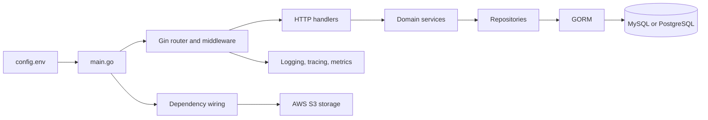

# Zekke

Zekke is a Go HTTP service starter with user and administrator APIs, JWT and API-key authentication, database-backed services, and optional telemetry. Its current application is built around Gin, GORM, and MySQL or PostgreSQL.

## What is implemented

- Health-check, user authentication and profile, refresh-token, and FCM-token endpoints.
- Administrator user and privilege-group operations.
- JWT middleware for authenticated API groups and `X-API-Key` middleware for internal routes.
- GORM models, explicit schema migration and seed commands, and MySQL/PostgreSQL drivers.
- Structured request logging, optional OpenTelemetry tracing, and optional Prometheus metrics.
- An AWS S3 storage implementation wired into the dependency container.

Redis client code and Firebase notification services are present, but neither is wired into the application startup. The FCM-token endpoints store tokens; they do not enable Firebase message delivery by themselves.

## Technology and architecture

| Component | Role |
| --- | --- |
| Go 1.26 | Application runtime |
| Gin | HTTP server, middleware, and routing |
| GORM | Database access and `AutoMigrate` schema updates |
| MySQL / PostgreSQL | Supported application database drivers |
| Viper | Reads `config.env` into the application configuration |
| Zerolog | Structured application and HTTP request logs |
| OpenTelemetry / Prometheus | Optional tracing export and Prometheus metrics |
| AWS SDK for Go v2 | S3-compatible object uploads |

`main.go` loads configuration, initializes telemetry and the database, builds the Gin middleware chain, wires repositories and services, registers routes, and starts the HTTP server. The `migrate` and `seed` CLI commands perform database operations without starting the server.



## Project layout

```text
.
├── api/                  Request/response DTOs and API helpers
│   ├── admin/
│   └── public/
├── base/                 Shared DTOs, constants, and helpers
├── core/
│   ├── database/          MySQL/PostgreSQL engines, migration, and seeding
│   ├── cache/             Redis client constructor (not wired at startup)
│   └── telemetry/         Logger, tracing, and metrics
├── data/model/            GORM models
├── modules/               Health, user, permission, and notification domains
│   └── */                 HTTP handlers/router, services, and repositories where applicable
├── server/
│   ├── middleware/        JWT and internal API-key middleware
│   └── router/            Route-group registration
├── test/
│   ├── mocks/             Generated Moq service doubles
│   └── service/           Service tests
├── util/                  Configuration, Firebase, log-trace, and storage helpers
├── config.env.example     Sample local configuration
└── main.go                Application entry point and database CLI
```

## Prerequisites

- Go 1.26 or newer (the module declares `go 1.26.0`).
- MySQL or PostgreSQL for running the application.
- Docker for the service test suite, which starts PostgreSQL with Testcontainers.
- An OTLP gRPC collector only if tracing is enabled; AWS credentials and an S3-compatible bucket only when using uploads.

The repository does not include a Docker Compose file, database provisioning scripts, or SQL migration files. Provision the database service and an empty database separately before starting the application.

## Local setup

Clone the repository and work from its root:

```sh
git clone https://github.com/Nicholaskrs/Zekke.git
cd Zekke
```

Copy the sample configuration:

```sh
cp config.env.example config.env
```

Edit `config.env` for your local database, replace the sample authentication values with private development values, and set `DB_DRIVER` to `mysql` or `postgres`. Make sure the configured database already exists. The committed example uses MySQL settings; PostgreSQL uses its own host port and driver setting.

Start the application:

```sh
go run main.go
```

The server listens on the address in `SERVER_PORT` (the example uses `:9000`). Check that the server is running by requesting `GET /api/v1/health`.

To initialize a database explicitly, run these from the repository root:

```sh
go run main.go migrate
go run main.go seed
```

The commands can also be run together as `go run main.go migrate seed`. Migrations use GORM `AutoMigrate`; there are no versioned SQL migration files. Seeding runs in a transaction and creates initial roles, privileges, and a built-in administrator account. Do not use the seeded account outside local development without changing its credentials.

## Configuration

`config.env` is required: `util/config` reads that file from the working directory. The values in `config.env.example` are sample settings, not application-level defaults. Use private values for secrets; do not commit your edited `config.env`.

For example, the relevant local settings might look like this; adjust database credentials to match the database you provisioned, and replace both authentication placeholders:

```env
DB_DRIVER=postgres
DB_HOST=localhost
DB_PORT=5432
DB_NAME=zekke
DB_USER=zekke
DB_PASSWORD=replace-with-your-local-database-password
JWT_SECRET=replace-with-a-long-random-local-value
JWT_ISSUER=zekke-local
API_KEY=replace-with-a-random-local-value
SERVER_PORT=:9000
OTEL_TRACE_ENDPOINT=
OTEL_METRICS_ENABLED=false
```

| Variable(s) | Purpose and notes |
| --- | --- |
| `DB_USER`, `DB_PASSWORD`, `DB_NAME`, `DB_HOST`, `DB_PORT` | Database connection. `DB_NAME` must refer to a database that already exists. |
| `DB_DRIVER` | Selects `mysql` or `postgres`. |
| `DB_TIMEZONE` | Database connection timezone. |
| `DB_MAX_OPEN_CONNS`, `DB_MAX_IDLE_CONNS` | SQL connection-pool limits. |
| `JWT_SECRET`, `JWT_ISSUER` | JWT signing and issuer configuration. |
| `API_KEY` | Expected value of the `X-API-Key` header on internal routes and the metrics endpoint. |
| `SERVER_PORT` | Gin server listen address, for example `:9000`. |
| `LOG_TYPE` | Set to `1` to enable GORM SQL query logging; otherwise SQL query logging is not enabled. |
| `OTEL_TRACE_ENDPOINT` | OTLP gRPC collector endpoint. An empty value disables trace export. |
| `OTEL_METRICS_ENABLED` | Boolean toggle for runtime and HTTP metrics plus the Prometheus endpoint. |
| `STORAGE_REGION`, `STORAGE_BUCKET`, `STORAGE_BASE_PATH`, `STORAGE_BASE_URL` | AWS S3 region, bucket, object-key prefix, and URL prefix for uploads. AWS credentials use the SDK's default credential chain. |
| `REDIS_ADDR`, `REDIS_PORT`, `REDIS_USERNAME`, `REDIS_PASSWORD` | Parsed Redis settings; Redis is not currently initialized by the application. |
| `HOST_DOMAIN` | Present in configuration, but currently unused; CORS is configured to allow all origins in `main.go`. |

For local development, the example file contains sample database, server, and telemetry values. Replace its authentication values and adjust the database driver/port to match your local service. Disable metrics with `OTEL_METRICS_ENABLED=false` and traces with an empty `OTEL_TRACE_ENDPOINT` if you do not have telemetry infrastructure.

## API overview

Routes are registered in `server/router/routes.go` and the domain routers under `modules/`.

| Route group | Examples | Access |
| --- | --- | --- |
| `/api/v1` | `GET /health`, `POST /auth/login`, `GET /user/profile`, `POST /user/refresh` | Health and login routes are registered without JWT middleware; authenticated user routes use JWT middleware. |
| `/api/admin` | `POST /user/filter`, `DELETE /user/user`, `POST /privilege-group/filter` | Admin user and permission route registrations use admin JWT middleware. |
| `/api-internal/v1` | `POST /user/register` | Requires the configured `X-API-Key`. |
| `/prometheus` | `GET /metrics` | Registered only when metrics are enabled; requires `X-API-Key`. |

The `/api/v1` examples above are paths relative to the application root. The full health-check URL with the sample server port is `http://localhost:9000/api/v1/health`.

## Testing

The service tests in `test/service` exercise service behavior using PostgreSQL. Their `TestMain` starts one PostgreSQL 16 Testcontainer for the package run; each test creates and migrates an isolated database. Docker must be running, and the PostgreSQL image must be available to the Docker daemon. These are database-backed integration/service tests, not a pure unit-only suite.

Run the service tests:

```sh
go test ./test/service
```

Run them with the race detector:

```sh
go test -race ./test/service
```

`DB_TIMEZONE` may be set for the test database; tests use `UTC` when it is unset. When changing an interface with generated doubles, regenerate the mocks with:

```sh
go generate ./test/mocks
```

## Observability and development notes

- Zerolog emits structured logs, and Gin requests are logged with status, path, latency, and trace/request context.
- Tracing exports over OTLP gRPC when `OTEL_TRACE_ENDPOINT` is non-empty.
- When `OTEL_METRICS_ENABLED=true`, HTTP/runtime metrics are exposed at `/prometheus/metrics`, protected by `X-API-Key`.
- CORS currently allows all origins while also allowing credentials. `HOST_DOMAIN` is not connected to the CORS configuration; review and restrict this behavior before exposing the service beyond local development.
- PostgreSQL migration includes the user and permission models. The MySQL migration currently includes only FCM-token and user models, so the permission features are not fully migrated with MySQL.
- Notification/Firebase and Redis components exist in the source tree but require further application wiring before they are part of the running service.
